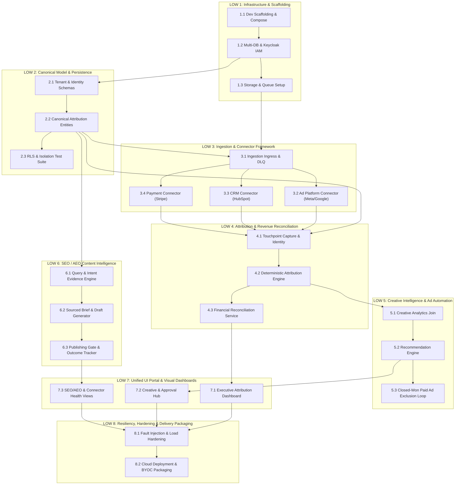

# KeelStream Engineering Execution Master Plan (`plan.md`)

> **Document Version:** 1.0.0  
> **Target System:** KeelStream Revenue Attribution & Performance Intelligence Engine  
> **Source Documents:** `keelstream_technical_prd_and_delivery_plan.docx` & `keelstream_project_plan_pricing.csv`  
> **Target Audience:** Antigravity Worker Agents & Engineering Team  
> **Execution Model:** Autonomous / Semi-Autonomous subagents running line-of-work tasks with deterministic verification gates.

---

## 1. Executive Architecture & Execution Principles

All worker agents executing tasks in this plan must adhere to the following core architectural rules derived from the technical PRD:

1. **Outcome-Led over Premature Infrastructure**: Build the narrow, verifiable revenue-attribution pipeline first. Defer multi-cloud packaging, marketplace metering, and high-scale distributed clusters (Kafka/OpenSearch) until measured throughput or paying customer volume strictly demands them.
2. **Strict Multi-Tenant Isolation**: Every database table, API endpoint, queue payload, cache key, and storage object must enforce `tenant_id` boundaries. Signature-only JWT validation is insufficient; authorization must occur at every data access layer.
3. **Deterministic & Explainable Attribution**: Version 1 attribution must be deterministic with configurable lookback windows. Raw touchpoints must remain immutable to allow retrospective recalculation. Never fabricate identity stitching—unmatched identities must remain explicitly unmatched.
4. **Human-in-the-Loop for Actuations**: All external write actions (ad spend adjustments, targeting exclusions, CMS publishing) require an explicit approval state machine (`PENDING_APPROVAL` -> `APPROVED` -> `EXECUTED`). No unreviewed AI-generated bulk updates.
5. **Fail-Closed Financial & Data Integrity**: When required inputs (spend, conversions, payments) are missing or stale, dashboards and APIs must report data gaps rather than computing misleading ROAS/CAC metrics.
6. **Self-Contained Verification**: Each task specifies its verification commands (tests, curl requests, or CLI checks). A task is not marked complete until its verification passes.

---

## 2. Global Execution Workflow for Antigravity Worker Agents

When an Antigravity worker agent is assigned to a task:
1. Read the task context, dependencies, and target deliverables in this document.
2. Verify that all preceding dependent tasks are complete (`[x]`).
3. Create/update the necessary files, migrations, services, and tests.
4. Run the automated verification commands specified under **Verification & Gate**.
5. Update the task checkbox in this `plan.md` to `[x]` upon success.

---

## 3. Workstream Breakdown & Task Dependency Graph



---

## Line of Work 1 (LOW 1): Infrastructure Blueprint & Local Environment Scaffolding

### Objective
Stand up the core local development and CI runtime with containerized databases, identity provider, storage, and orchestration tooling.

- [x] **Task 1.1: Docker Compose Local Environment Scaffolding**
  - **Worker Role:** Platform / DevOps Engineer
  - **Inputs:** Docker, Docker Compose specifications.
  - **Deliverables:**
    - `docker-compose.yml` containing:
      - PostgreSQL 16+ instance.
      - Redis (for caching and durable task queues).
      - MinIO / RustFS container (S3-compatible object storage).
      - Keycloak 24+ container with OIDC pre-configured.
      - Vue attribution dashboard, built from `frontend/` and exposed on configurable `FRONTEND_PORT`.
      - (Optional/Staged) n8n container for workflow orchestration.
    - `.env.example` with standard defaults for local emulation.
    - `scripts/dev-up.sh` (and `scripts/dev-up.ps1` for Windows) to provision volumes and network bridges.
  - **Verification & Gate:**
    ```bash
    docker compose up -d
    docker compose ps # All containers healthy
    curl -I http://localhost:8080 # Keycloak responds
    curl -I http://localhost:9000/minio/health/live # S3 storage responds
    ```

- [ ] **Task 1.2: Multi-Database Scaffolding & Keycloak IAM Integration**
  - **Worker Role:** Backend & IAM Engineer
  - **Inputs:** PostgreSQL container, Keycloak admin credentials.
  - **Deliverables:**
    - `scripts/init-databases.sql`: creates isolated logical databases (`db_keycloak`, `db_keelstream_core`, `db_frappe`).
    - Keycloak realm configuration (`config/keycloak/keelstream-realm.json`) with:
      - Custom realm `keelstream`.
      - OIDC clients for `keelstream-api` and `keelstream-portal`.
      - Tenant mapper claims injecting `tenant_id` and user roles into JWT tokens.
    - Script `scripts/setup-keycloak.py` to auto-import realms and create test service accounts.
  - **Verification & Gate:**
    ```bash
    python scripts/setup-keycloak.py
    # Test token acquisition & payload check
    curl -X POST "http://localhost:8080/realms/keelstream/protocol/openid-connect/token" \
      -d "client_id=keelstream-api" -d "grant_type=client_credentials" -d "client_secret=..."
    # Verify JWT contains tenant claim
    ```

- [ ] **Task 1.3: S3 Storage & Asynchronous Worker Queue Setup**
  - **Worker Role:** Backend Infrastructure Engineer
  - **Inputs:** MinIO / RustFS, Redis.
  - **Deliverables:**
    - Storage helper module (`core/storage/s3.py`): client wrapper for uploading, presigning URLs, and bucket lifecycle management.
    - Asynchronous worker setup (`core/queue/worker.py`): lightweight task queue (Celery or RQ backed by Redis) with retry limits, exponential backoff, and dead-letter queues.
    - Initialization script `scripts/init-buckets.py` creating buckets: `keelstream-assets`, `keelstream-exports`, `keelstream-dlq`.
  - **Verification & Gate:**
    ```bash
    pytest tests/unit/test_storage.py
    pytest tests/unit/test_queue.py
    ```

---

## Line of Work 2 (LOW 2): Canonical Data Model & Multi-Tenant Persistence

### Objective
Implement the relational database schema defining all core entities, tenancy boundaries, audit trails, and strict tenant isolation checks.

- [x] **Task 2.1: Tenant, User, and Connection Schemas**
  - **Worker Role:** Database & Backend Engineer
  - **Inputs:** Canonical schema specs in PRD Section 6.
  - **Deliverables:**
    - Migration scripts (Alembic / SQL) defining:
      - `tenants` (id, name, slug, tier, status, settings, created_at).
      - `users` (id, tenant_id, email, full_name, role, auth_provider_id).
      - `source_connections` (id, tenant_id, provider, name, auth_type, status, last_synced_at).
      - `credential_references` (id, tenant_id, connection_id, vault_key_or_encrypted_blob).
    - Base repository interface with mandatory `tenant_id` scoping on all queries.
  - **Verification & Gate:**
    ```bash
    pytest tests/db/test_tenants_and_auth.py
    ```

- [ ] **Task 2.2: Marketing, Touchpoint, and Revenue Schemas**
  - **Worker Role:** Data Architect / Backend Engineer
  - **Inputs:** Canonical schema specs for advertising and revenue entities.
  - **Deliverables:**
    - Migration scripts creating:
      - **Advertising:** `campaigns`, `ad_groups`, `ads`, `creative_assets`, `creative_versions`, `spend_metrics`.
      - **Touchpoints & Identity:** `touchpoints` (id, tenant_id, visitor_id, session_id, utm_source, utm_medium, utm_campaign, utm_content, click_id, url, referrer, timestamp), `identities` (id, tenant_id, anonymous_id, verified_email, phone_hash, confidence_score).
      - **CRM & Revenue:** `leads`, `accounts`, `opportunities`, `customers`, `conversion_events`, `payment_events` (id, tenant_id, source_id, amount, currency, status, refunded_amount, timestamp).
      - **Content (SEO/AEO):** `content_assets`, `content_versions`, `search_queries`, `search_metrics`, `publications`.
      - **Attribution & Audit:** `attribution_results`, `recommendations`, `action_approvals`, `audit_events`, `sync_runs`, `dead_letter_records`.
    - Constraints: composite unique indexes including `(tenant_id, source_system, source_record_id)` for idempotent upserts.
  - **Verification & Gate:**
    ```bash
    pytest tests/db/test_canonical_models.py
    ```

- [ ] **Task 2.3: Multi-Tenant Negative Test Matrix & Row-Level Security**
  - **Worker Role:** Security & QA Engineer
  - **Inputs:** Database models and Keycloak tenant context.
  - **Deliverables:**
    - Automated security test suite (`tests/security/test_tenant_isolation.py`).
    - Tests verifying:
      - Tenant A cannot query, update, or delete records belonging to Tenant B via direct queries or API services.
      - Background worker jobs cannot cross tenant boundaries.
      - S3 presigned URLs strictly restrict tenant file paths (`/tenants/{tenant_id}/...`).
  - **Verification & Gate:**
    ```bash
    pytest tests/security/test_tenant_isolation.py -v # Must show 100% pass rate
    ```

---

## Line of Work 3 (LOW 3): Ingestion Pipeline & Connector Framework

### Objective
Create a fault-tolerant ingestion engine supporting scheduled syncs and inbound webhooks with provenance tracking, rate limiting, deduplication, and dead-letter handling.

- [x] **Task 3.1: Ingestion Ingress, Provenance Tracking & Dead-Letter Queue**
  - **Worker Role:** Data Pipeline Engineer
  - **Inputs:** Ingestion specs in PRD Section 5 (FR-01 to FR-03).
  - **Deliverables:**
    - Ingestion endpoint: `POST /api/v1/ingest/{source_type}`.
    - Middleware extracting tenant context, validating HMAC / signature tokens.
    - Provenance envelope wrapper recording: `source_system`, `source_record_id`, `event_time`, `ingestion_time`, `tenant_id`, `schema_version`, and `idempotency_key`.
    - Ingestion failure handler: moves unparseable or retried-out payloads to `dead_letter_records` table with error stack trace and replay flag.
    - Replay API: `POST /api/v1/ingest/dlq/{id}/replay`.
  - **Verification & Gate:**
    ```bash
    pytest tests/ingestion/test_ingress_and_dlq.py
    ```

- [ ] **Task 3.2: Ad Platform Connector (Meta Ads / Google Ads)**
  - **Worker Role:** Backend Integration Engineer
  - **Inputs:** Ad Platform reporting API specifications.
  - **Deliverables:**
    - Connector interface `core/connectors/base.py` (methods: `authenticate()`, `fetch_campaigns()`, `fetch_spend()`, `sync()`).
    - Implementation `core/connectors/ads/meta_ads.py` (and mock harness):
      - Extracts campaign, ad group, ad, creative assets, impressions, clicks, and daily spend.
      - Checkpoint cursor storage in `sync_runs`.
      - Deduplication against existing `spend_metrics` by `(tenant_id, ad_id, date)`.
  - **Verification & Gate:**
    ```bash
    pytest tests/connectors/test_ad_connector.py
    ```

- [ ] **Task 3.3: CRM Lifecycle Connector (HubSpot / Salesforce)**
  - **Worker Role:** Backend Integration Engineer
  - **Inputs:** CRM contact and deal pipeline models.
  - **Deliverables:**
    - Implementation `core/connectors/crm/hubspot.py`:
      - Syncs Contacts $\rightarrow$ `leads`/`identities`.
      - Syncs Deals/Pipelines $\rightarrow$ `opportunities`/`customers`.
      - Captures lifecycle stage transitions and timestamps.
      - Webhook receiver for real-time contact creation and deal stage changes.
  - **Verification & Gate:**
    ```bash
    pytest tests/connectors/test_crm_connector.py
    ```

- [ ] **Task 3.4: Payment & Revenue Connector (Stripe)**
  - **Worker Role:** Backend Integration Engineer
  - **Inputs:** Stripe charge, invoice, and payment intent webhooks.
  - **Deliverables:**
    - Implementation `core/connectors/payment/stripe.py`:
      - Webhook verification using Stripe webhook secret.
      - Handles `payment_intent.succeeded`, `invoice.payment_succeeded`, `charge.refunded`.
      - Ingests into `payment_events` with gross amount, currency, fee, refund status, and customer email reference.
      - Handles multi-currency normalizations.
  - **Verification & Gate:**
    ```bash
    pytest tests/connectors/test_payment_connector.py
    ```

---

## Line of Work 4 (LOW 4): Deterministic Attribution & Revenue Reconciliation Engine

### Objective
Implement the core value-add: deterministic touchpoint attribution and financial reconciliation against actual bank/Stripe revenue.

- [x] **Task 4.1: Client-Side Touchpoint Capture & Identity Binding**
  - **Worker Role:** Frontend / Tracking Engineer
  - **Inputs:** PRD Section 5 (FR-04) and Section 8 (Feedback Loop A).
  - **Deliverables:**
    - Lightweight client tracking snippet `static/keelstream.js`:
      - Extracts UTM parameters (`utm_source`, `utm_medium`, `utm_campaign`, `utm_content`, `utm_term`).
      - Extracts ad click IDs (`gclid`, `fbclid`, `msclkid`, `ttclid`).
      - Generates anonymous client ID; respects Do Not Track (DNT) / consent status.
      - Submits beacon to `/api/v1/track`.
    - Server-side identity resolution service (`core/attribution/identity.py`):
      - Links anonymous visitor IDs to verified CRM email when a form submission or identifier event occurs.
      - Never overwrites or guesses identities without explicit consent or match key.
  - **Verification & Gate:**
    ```bash
    pytest tests/attribution/test_touchpoint_capture.py
    ```

- [ ] **Task 4.2: Deterministic Multi-Model Attribution Engine**
  - **Worker Role:** Analytics & Algorithms Engineer
  - **Inputs:** PRD Section 5 (FR-05) and Section 8 (Loop A).
  - **Deliverables:**
    - Attribution calculation engine `core/attribution/engine.py` supporting:
      - **First-Touch Model:** 100% credit to the earliest recorded touchpoint within lookback window.
      - **Last-Touch Model:** 100% credit to the final touchpoint prior to conversion.
      - **Linear Multi-Touch Model:** Equal credit distributed across all valid journey touchpoints.
      - **Position-Based (40-40-20) Model:** 40% first, 40% last, 20% split among intermediate touchpoints.
    - Configurable lookback windows (e.g., 30, 60, 90 days).
    - Immutable results storage in `attribution_results` containing `model_version`, `model_name`, `confidence_score`, and `unmatched_reason`.
  - **Verification & Gate:**
    ```bash
    pytest tests/attribution/test_attribution_engine.py
    ```

- [ ] **Task 4.3: Revenue Reconciliation & Financial Discrepancy Reporting**
  - **Worker Role:** Financial Systems / Backend Engineer
  - **Inputs:** PRD Section 5 (FR-06) and Section 11 (Acceptance tests).
  - **Deliverables:**
    - Reconciliation engine `core/attribution/reconciliation.py`:
      - Compares ad-attributed conversions and CRM revenue against actual `payment_events`.
      - Detects discrepancies: disputed charges, refunded payments, cancelled subscriptions, currency conversions.
      - Produces `ReconciliationReport`:
        - Total payment source revenue vs. Total attributed revenue.
        - Unattributed revenue percentage.
        - Discrepancy list with drill-down links.
      - Blocks calculation of ROAS/CAC when spend data or payment data has missing intervals.
  - **Verification & Gate:**
    ```bash
    pytest tests/attribution/test_reconciliation.py
    ```

---

## Line of Work 5 (LOW 5): Ad Creative Intelligence & Paid Ad Exclusion Loop

### Objective
Deliver Feedback Loop B: join creative version performance with mature revenue outcomes, surface evidence-based recommendations, and automate paid ad exclusions for closed-won customers.

- [x] **Task 5.1: Creative Performance & Revenue Join Service**
  - **Worker Role:** Data & Analytics Engineer
  - **Inputs:** PRD Section 5 (FR-08) and Section 8 (Loop B).
  - **Deliverables:**
    - Analytics query module `core/analytics/creative_join.py`:
      - Joins `creative_versions` $\rightarrow$ `ads` $\rightarrow$ `touchpoints` $\rightarrow$ `payment_events`.
      - Computes mature metrics: Conversion Maturity Delay (accounts for sales cycle lag before judging creative effectiveness).
      - Enforces minimum sample size threshold (e.g. minimum 100 clicks or 10 conversions before calculating performance significance).
  - **Verification & Gate:**
    ```bash
    pytest tests/analytics/test_creative_join.py
    ```

- [ ] **Task 5.2: Evidence-Based Recommendation Engine & Approval Gate**
  - **Worker Role:** Backend / ML Engineer
  - **Inputs:** PRD Section 5 (FR-08, FR-09).
  - **Deliverables:**
    - Recommendation generator `core/recommendations/engine.py`:
      - Generates structured recommendations (e.g., "Pause Creative X", "Reallocate budget from AdGroup Y to Z").
      - Every recommendation includes: `evidence_summary`, `sample_size`, `statistical_confidence`, `maturity_status`, and `projected_impact`.
      - If sample size or maturity window is insufficient, the engine explicitly outputs `INSUFFICIENT_DATA` rather than a guess.
    - Approval state machine:
      - Records state in `action_approvals` (`PENDING`, `APPROVED`, `REJECTED`, `EXECUTED`, `CANCELLED`).
      - Requires explicit user authorization before any external action can run.
  - **Verification & Gate:**
    ```bash
    pytest tests/recommendations/test_recommendations.py
    ```

- [ ] **Task 5.3: Closed-Won Paid Ad Exclusion Loop**
  - **Worker Role:** Integration & Automation Engineer
  - **Inputs:** CSV Item 11 ("Paid Ad Exclusion Loop Implementation") and PRD Section 5 (FR-09).
  - **Deliverables:**
    - Customer exclusion worker `core/automation/ad_exclusion.py`:
      - Triggers when a deal is updated to `Closed-Won` in the CRM or a first payment succeeds in Stripe.
      - Hashes customer identifier (SHA-256 email/phone).
      - Calls Ad Platform Custom Audience API (e.g., Meta Custom Audience / Google Customer Match) to add identifier to `Excluded_Existing_Customers` list.
      - Maintains audit log of exclusion additions and handles API rate limits/errors.
  - **Verification & Gate:**
    ```bash
    pytest tests/automation/test_ad_exclusion.py
    ```

---

## Line of Work 6 (LOW 6): SEO / AEO Content Intelligence Workflow

### Objective
Deliver Feedback Loop C: generate search intent-driven content briefs and drafts grounded in verifiable evidence, governed by quality gates and post-publication tracking.

- [x] **Task 6.1: Search Intent & Evidence Ingestion Engine**
  - **Worker Role:** SEO & Data Engineer
  - **Inputs:** PRD Section 5 (FR-10) and Section 8 (Loop C).
  - **Deliverables:**
    - Search intelligence collector `core/seo/intent_collector.py`:
      - Ingests search query data, impressions, clicks, and average positions (Google Search Console API / SerpAPI mock).
      - Maps queries into intent clusters (Informational, Commercial, Transactional).
      - Identifies content gaps and revenue-attributable keyword opportunities.
  - **Verification & Gate:**
    ```bash
    pytest tests/seo/test_intent_collector.py
    ```

- [ ] **Task 6.2: Sourced Content Brief & Quality Validation Gate**
  - **Worker Role:** AI & Content Pipeline Engineer
  - **Inputs:** PRD Section 5 (FR-10).
  - **Deliverables:**
    - Sourced brief generator `core/seo/brief_generator.py`:
      - Generates structured briefs containing target keywords, competitor references, recommended headers, and required source claims.
    - Automated Quality Validation Pipeline `core/seo/validator.py`:
      - **Fact & Source Check:** every quantitative claim must link to a valid source URL or dataset.
      - **Duplication Check:** evaluates semantic similarity against existing site URLs to prevent keyword cannibalization.
      - **Metadata & Schema Check:** verifies Title, Meta Description, OpenGraph tags, and valid JSON-LD schema markup.
    - Rejection gate: drafts failing validation are blocked from publishing approval.
  - **Verification & Gate:**
    ```bash
    pytest tests/seo/test_content_validator.py
    ```

- [ ] **Task 6.3: Gated CMS Publishing & Post-Publication Outcome Tracking**
  - **Worker Role:** Integration & Fullstack Engineer
  - **Inputs:** PRD Section 5 (FR-10, FR-11).
  - **Deliverables:**
    - Publishing adapter `core/seo/publisher.py`:
      - Supports publishing to WordPress / Webflow / Ghost via authenticated REST API.
      - Only triggers when status in `action_approvals` is `APPROVED`.
    - Outcome tracker `core/seo/tracker.py`:
      - Monitors post-publication URL indexing status.
      - Tracks organic impressions, clicks, and downstream conversions attributable to the published article.
      - Generates transparent AEO (Answer Engine Optimization) citations log noting search engine, query, date, and excerpt.
  - **Verification & Gate:**
    ```bash
    pytest tests/seo/test_publisher_and_tracker.py
    ```

---

## Line of Work 7 (LOW 7): Unified Multi-Tenant UI Portal & Single-Pane Dashboards

### Objective
Construct the agency-facing portal providing unified visibility into attribution, creative intelligence, content workflows, and connector freshness.

- [x] **Task 7.1: Executive Attribution & Revenue Reconciliation Dashboard**
  - **Worker Role:** Frontend Engineer (Vue / React / Frappe UI)
  - **Inputs:** PRD Section 5 (FR-07) and CSV Phase 5.
  - **Deliverables:**
    - Runnable Vue dashboard application and container image (`frontend/`) served by the Compose `frontend` service on configurable `FRONTEND_PORT`.
    - Dashboard interface displaying:
      - KPI cards: Total Ad Spend, Total Attributed Revenue, Blended ROAS, CAC.
      - Missing data banners: warns if spend or payment data has gaps.
      - Attribution breakdown chart: compares First-Touch vs. Last-Touch vs. Multi-Touch.
      - Drill-down drawer: clicking any KPI displays underlying records with timestamps and source IDs.
  - **Verification & Gate:**
    ```bash
    docker compose build frontend
    pytest tests/frontend/test_attribution_dashboard.py
    ```

- [ ] **Task 7.2: Creative Intelligence & Human Approval Inbox**
  - **Worker Role:** Frontend Engineer
  - **Inputs:** PRD Section 5 (FR-08, FR-09).
  - **Deliverables:**
    - Interactive recommendation review interface:
      - Displays active creative recommendations with evidence tags, sample sizes, and maturity warnings.
      - Action controls: "Approve Recommendation", "Reject", "Adjust Parameters".
      - Audit history modal showing who approved each action and execution status.
  - **Verification & Gate:**
    ```bash
    npm run test:e2e -- tests/e2e/approval_inbox.spec.ts
    ```

- [ ] **Task 7.3: SEO / AEO Content Hub & Connector Operations Portal**
  - **Worker Role:** Frontend Engineer
  - **Inputs:** PRD Section 5 (FR-11, FR-13).
  - **Deliverables:**
    - Content Hub UI:
      - Pipeline view: Research $\rightarrow$ Draft $\rightarrow$ Quality Review $\rightarrow$ Scheduled $\rightarrow$ Published.
      - Post-publish metrics: views, conversions, organic rank, AEO visibility.
    - System Operations page:
      - Source connection health matrix (Meta, HubSpot, Stripe status, last sync timestamp, lag in minutes).
      - Dead-letter record manager with one-click replay.
  - **Verification & Gate:**
    ```bash
    npm run test:e2e -- tests/e2e/operations_portal.spec.ts
    ```

---

## Line of Work 8 (LOW 8): Hardening, Resiliency, Unit Economics & Delivery Packaging

### Objective
Fulfill CSV Phase 6 & 7 and PRD Section 9, 13 & 14: harden platform resiliency, isolate faults, verify unit economics tracking, and package for single-cloud and BYOC customer deployments.

- [x] **Task 8.1: Resiliency Hardening, Fault Injection & Load Test Suite**
  - **Worker Role:** SRE / Performance Engineer
  - **Inputs:** CSV Phase 7 ("Fault-Tolerant Resiliency Hardening & Load Test") and PRD Section 9.
  - **Deliverables:**
    - Chaos / Fault injection test suite (`tests/resiliency/test_fault_tolerance.py`):
      - Simulates expired credentials, rate limiting (HTTP 429), database disconnects, and webhooks bursts.
      - Verifies that rate-limited tasks back off gracefully and burst payloads are queued without data loss.
    - Load test script using Locust or k6 (`tests/load/ingestion_load.js`):
      - Tests sustained ingestion of 500 events/second.
      - Assesses latency and verifies zero cross-tenant contamination under load.
  - **Verification & Gate:**
    ```bash
    k6 run tests/load/ingestion_load.js
    pytest tests/resiliency/test_fault_tolerance.py
    ```

- [ ] **Task 8.2: Tenant Cost Tracking & Gross Margin Telemetry**
  - **Worker Role:** Backend / FinOps Engineer
  - **Inputs:** PRD Section 13 ("Pricing and unit economics").
  - **Deliverables:**
    - Usage metering engine `core/billing/metering.py`:
      - Records resource units consumed per tenant: database storage (MB), ingested event count, LLM tokens consumed, presigned media requests.
      - Direct cost calculator estimating gross margin against tenant retainer tier ($1,500 / $3,500).
      - Configurable alerts triggered if tenant direct cost approaches margin threshold (< 70%).
  - **Verification & Gate:**
    ```bash
    pytest tests/billing/test_metering.py
    ```

- [ ] **Task 8.3: Infrastructure-as-Code & BYOC / Marketplace Packaging**
  - **Worker Role:** Cloud Architect / DevOps Engineer
  - **Inputs:** CSV Phase 6 ("Cloud-Native Automated Layout Scaffolding") and PRD Section 4 & 7.
  - **Deliverables:**
    - Terraform / CloudFormation blueprint (`deploy/aws/`):
      - Provisions VPC, RDS PostgreSQL, ElastiCache Redis, S3 bucket, and ECS / EKS application services.
      - Self-contained BYOC (Bring Your Own Cloud) installation module allowing enterprise agencies to deploy into their own AWS/Azure accounts.
      - Automated backup and point-in-time recovery verification script (`scripts/test-backup-restore.sh`).
  - **Verification & Gate:**
    ```bash
    cd deploy/aws && terraform validate
    bash scripts/test-backup-restore.sh
    ```

---

## 4. Acceptance Criteria & Final Definition of Done (DoD)

Before the MVP is handed off to customer design partners, the following acceptance criteria must be satisfied:

1. **Reconciliation Accuracy**: Sampled revenue reconciles within 100% mathematical precision against Stripe/bank payment events. Any gap is explicitly marked in the report.
2. **Zero Cross-Tenant Leakage**: Automated negative security tests pass with 0 failures across all endpoints, queries, caches, and storage objects.
3. **Audit Trail Completeness**: 100% of user-authorized actions (ad exclusions, content publications, recommendations) contain a non-repudiable audit event.
4. **Resiliency**: Webhook ingestion recovers from network interruptions with zero duplicate records and zero lost events via idempotency and DLQ replay.
5. **Human Approval Safeguard**: No automated ad spend change or article publication can trigger without an `APPROVED` record in `action_approvals`.
